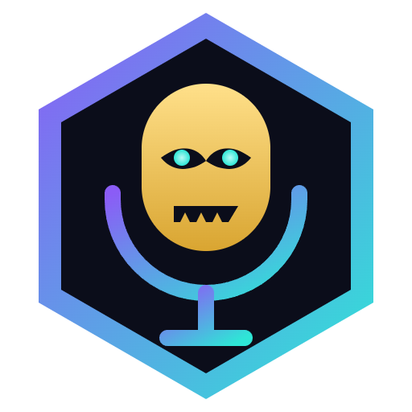

<p align="center">
  
</p>

# Cursed Voices

> **Ta voix, maudite.**
> Modificateur de voix et soundboard pour le stream, à la manière de Voicemod.

- **Voix** : un clic sur un médaillon et ta voix change, en direct, dans OBS, Discord ou Twitch Studio.
- **Labo** : empile des effets (hauteur et timbre, robot, réverbe, écho, distorsion, bitcrusher, égaliseur, filtre, chorus, flanger, vibrato, trémolo, noise gate, compresseur, volume), règle-les **en t'écoutant en direct**, et enregistre ta voix avec son logo (icône, emoji ou ta propre image).
- **Soundboard** : des sons courts sur des pads, au clavier (raccourcis globaux) ou au **clavier MIDI** (apprentissage en un coup de pad).
- **Mises à jour en un clic** : le bouton doré « Mettre à jour » installe la dernière version publiée ici.
- **Français / English** : choisi à l'installation, modifiable dans Paramètres > Application.

## Installation

1. Ouvre la page **[Releases](https://github.com/AzsraProjects/CursedVoices/releases/latest)** et télécharge `CursedVoices-Setup-x.y.z.exe`.
2. Double-clique dessus, choisis ta langue, puis suis l'installation (sans droits administrateur).
3. Si le câble audio virtuel **VB-CABLE** n'est pas sur ton PC, l'installeur propose de le télécharger depuis vb-audio.com et ouvre son installateur officiel : clique sur **Install Driver**. Un redémarrage peut être demandé.
4. Si Windows affiche « Windows a protégé votre ordinateur » : **Informations complémentaires > Exécuter quand même** (l'exécutable n'est pas encore signé).

Les versions suivantes s'installent depuis l'application (bouton **Mettre à jour**).

## Brancher sur OBS

1. Dans OBS, **Sources > + > Capture d'entrée audio**.
2. Périphérique : **CABLE Output (VB-Audio Virtual Cable)**.
3. Coupe ton micro habituel dans le mixeur d'OBS, sinon ta vraie voix passe en double.
4. Parle : la jauge d'OBS bouge.

Les mêmes étapes sont dans l'application, Paramètres > OBS & Stream.

## Comment ça marche

```
               ┌── graphe "stream"  ──► CABLE Input ──► OBS (CABLE Output)
micro ──► ─────┤
               └── graphe "écoute"  ──► ton casque (bouton 👂)
```

- Tout le son passe par Web Audio dans Electron. Deux graphes identiques lisent le même micro, chacun lié directement à son périphérique : la latence reste la plus basse possible des deux côtés.
- Le pitch-shifter est un vocodeur de phase (FFT 1024, recouvrement 8) avec **préservation des formants** par enveloppe cepstrale et **verrouillage de phase** (Laroche-Dolson) : la voix descend ou monte sans effet chipmunk ni son métallique (`public/worklets/pitch-shifter.js`).
- **Fiabilité** : la sortie stream ne retombe jamais sur les haut-parleurs (pas de larsen en live), les changements de voix sont fondus sur 40 ms (aucun clic), un limiteur protège la sortie, un chien de garde relance le micro ou l'audio s'ils décrochent, et les données sont écrites de façon atomique avec copie de secours (`%APPDATA%\Cursed Voices`).
- La croix réduit la fenêtre dans la zone de notification : la voix reste active pendant le stream.

## Développement

Prérequis : Node.js 22.

```bash
npm install
npm run dev        # Vite + Electron
npm test           # tests du traitement du signal
npm run typecheck
npm run dist       # installeur dans release/
```

Test de démarrage complet (ce que fait la CI avant chaque publication) :

```powershell
npm run build
$env:CV_SMOKE="$env:TEMP\cv-smoke"; $env:CV_SMOKE_PAGES="voices,lab,soundboard,settings"; $env:CV_SMOKE_SELFTEST="1"
npx electron .
```

Il capture chaque page et mesure chaque voix hors temps réel : une voix qui souffle, sature ou change de volume de plus de 6 dB bloque la publication.

Chaque push sur `main` est testé, compilé et publié automatiquement (`.github/workflows/release.yml`).

## Crédits

- VB-CABLE est un logiciel gratuit de VB-Audio (www.vb-cable.com), financé par les dons. Cursed Voices ne l'embarque pas : il le télécharge depuis le site officiel et ouvre son installateur, avec sa propre licence.
- Stack : Electron · React · TypeScript · Tailwind · Web Audio / AudioWorklet · electron-updater.
